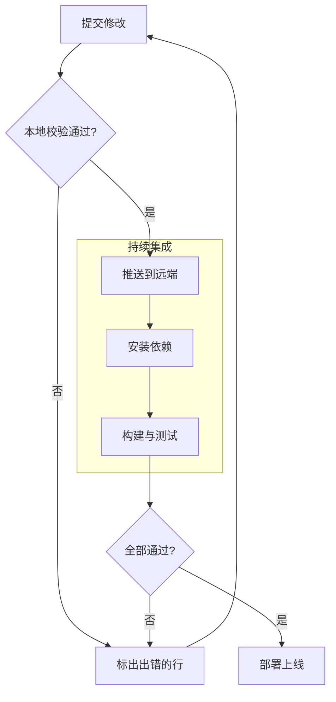
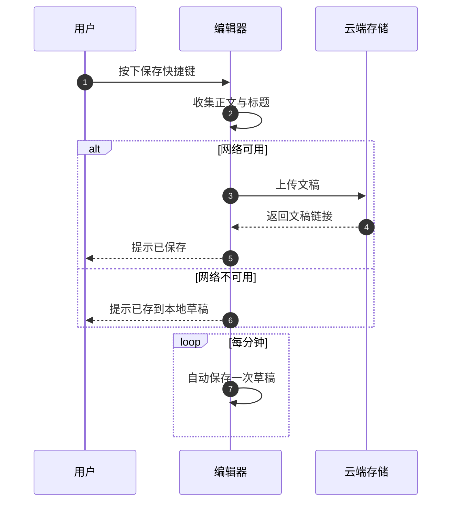

# hj-editor 操作说明

> 版本：0.0.0（开发版）
> 文档更新：2026-10

随时按 `Ctrl + Shift + /`（macOS 为 `⌘ + ⇧ + /`）打开内置帮助，左侧栏底部也有入口。

---

## 一、快捷键

键位说明：

- 文中 `Ctrl` 在 macOS 上对应 `⌘`，`Alt` 对应 `⌥`，`Shift` 对应 `⇧`。
- 快捷键不是写死的：在帮助面板的「快捷键」页点击键位，按下新的组合键即可改；`Backspace` 恢复该项默认值，`Esc` 取消录制。改动即时生效并记住，侧栏提示、按钮 tooltip 和「/」菜单里的键位提示会一起更新。
- 自定义键位必须带 `Ctrl / ⌘` 或 `Alt`，与打字区分开；若和已有快捷键冲突，面板会提示占用了哪个功能。

### 1.1 文档

| 快捷键 | 功能 |
| --- | --- |
| `Ctrl + S` | 保存草稿 |
| `Ctrl + Shift + S` | 保存到云端 |
| `Ctrl + O` | 导入文件 |
| `Ctrl + /` | 打开 / 关闭 Markdown 源码 |
| `Ctrl + Shift + /` | 快捷键与语法帮助 |
| `Ctrl + Z` | 撤销 |
| `Ctrl + Shift + Z` | 重做 |

### 1.2 文本格式

| 快捷键 | 功能 |
| --- | --- |
| `Ctrl + B` | 加粗 |
| `Ctrl + I` | 斜体 |
| `Ctrl + E` | 行内代码 |
| `Ctrl + Alt + H` | 高亮 |

下划线没有默认快捷键，用工具栏按钮；删除线的默认键位 `Ctrl + Shift + S` 与「保存到云端」相同，实际按下会触发保存，想在正文里用删除线，请在快捷键面板把它改成别的组合。

### 1.3 段落

| 快捷键 | 功能 |
| --- | --- |
| `Ctrl + Alt + 0` | 正文 |
| `Ctrl + Alt + 1` ~ `4` | 标题 1 ~ 4 |
| `Ctrl + Shift + B` | 引用 |
| `Ctrl + Shift + 8` | 无序列表 |
| `Ctrl + Shift + 7` | 有序列表 |
| `Ctrl + Shift + 9` | 任务列表 |

### 1.4 插入

| 快捷键 | 功能 |
| --- | --- |
| `Ctrl + Alt + C` | 代码块 |
| `Ctrl + Alt + T` | 表格 3 × 3 |
| `Ctrl + Alt + D` | 分割线 |
| `Ctrl + Alt + G` | 流程图（Mermaid 代码块） |
| `Ctrl + Alt + E` | 数据图表（ECharts 代码块） |
| `Ctrl + Alt + M` | 行内公式 |
| `Ctrl + Alt + Shift + M` | 块级公式 |

### 1.5 视图

| 快捷键 | 功能 |
| --- | --- |
| `Ctrl + Shift + H` | 收起 / 展开侧栏 |
| `Ctrl + Shift + .` | 写作模式（隐藏侧栏） |
| `Ctrl + Shift + L` | 激光笔 / 页面批注 |

### 1.6 激光笔

进入激光笔后生效，与正文快捷键互不干扰；同样可在设置面板中改写。

| 快捷键 | 功能 |
| --- | --- |
| `1` ~ `7` | 自由笔 / 直线 / 矩形 / 椭圆 / 箭头 / 文字 / 移动 |
| `F` | 切换渐隐与保留 |
| `C` | 清空批注 |
| `S` | 截屏保存 |
| `Ctrl + Z` | 撤销一笔 |
| `Esc` | 退出激光笔 |

### 1.7 通用按键

| 按键 | 功能 |
| --- | --- |
| `Esc` | 关闭当前浮层（菜单、抽屉、面板、帮助、激光笔） |
| `/` | 光标处打开插入菜单 |
| `↑` / `↓` / `Enter` / `Esc` | 插入菜单内选择、确认、关闭 |
| `Shift + 粘贴` | 保留纯文本原文，不解析 Markdown |
| `Tab` | 代码块内缩进（2 个空格） |

---

## 二、语法

直接在正文里输入 Markdown 语法，回车或闭合标记后自动转换；也可以输入 `/` 从菜单里选插入项。

### 2.1 Markdown 基础

| 语法 | 写法 |
| --- | --- |
| 标题 | `# 一级标题` … `#### 四级标题`（最多四级） |
| 加粗 / 斜体 / 删除线 | `**文本**` / `*文本*` / `~~文本~~` |
| 行内代码 | `` `代码` `` |
| 链接 / 图片 | `[文字](https://example.com)` / `` |
| 引用 | `> 引用内容` |
| 无序列表 | `- 项目` |
| 有序列表 | `1. 项目` |
| 任务列表 | `- [ ] 待办事项` |
| 表格 | `\| 列 A \| 列 B \|` |
| 分割线 | `---` |
| 代码块 | 输入 `` ``` `` 后回车，可选语言标识 |
| 行内公式 | `$E = mc^2$` |
| 块级公式 | 空行输入 `$$` 回车，或直接写 `$$公式$$` |
| 流程图 | 代码块语言写 `mermaid`，或直接输入 `` ```mermaid `` 回车 |
| 数据图表 | 代码块语言写 `echarts`，或直接输入 `` ```echarts `` 回车 |

补充：

- 公式由 KaTeX 渲染；双击公式可改 LaTeX，留空即删除。
- 代码块超过 8 行时右上角出现「折叠」，折叠后在块下方点「展开代码」。
- 粘贴看起来像 Markdown 的内容会自动排成富文本；按住 `Shift` 粘贴则保留原文。
- 代码块未写语言标识时，会按内容识别常见语言，识别不出就保持纯文本。

### 2.2 数据图表（ECharts）

语言标识写 `echarts`（`echart`、`chart` 同样识别），块内直接写 ECharts 的 `option`，代码块下方实时出图。

写法要点：

- **JSON 写法**：只做解析、不执行代码；允许整行 `//` 注释、`/* */` 块注释与尾逗号。
- **JS 写法**：可以声明变量、循环、`map`、模板字符串，也能写 `formatter` 之类的函数，最后交出 option 对象。作用域里已提供 `echarts` 命名空间，官网示例里的 `new echarts.graphic.LinearGradient(…)` 可以原样贴进来。JS 会在页面里执行，只打开可信的文档。
- **高度**：首行写 `// height: 380` 指定画布高度，取值 160–900，不写默认 360。
- **源码显隐**：编辑时图表下方有「隐藏代码 / 显示代码」按钮，收起后正文只留图表，Markdown 源码与导出内容不受影响；只读的分享页默认收起代码，读者点「显示代码」才会看到。
- 图表滚动到视口附近才初始化，配色跟随深浅主题重画；配置写错时错误信息显示在代码块下方，源码保留。

示例 1 · 折线图（JSON 写法，双系列 + 均值线）：

```echarts
// height: 360
{
  "color": ["#3B9EFF", "#36CBCB"],
  "tooltip": { "trigger": "axis" },
  "legend": { "top": 0, "data": ["访问量", "订单量"] },
  "grid": { "left": 48, "right": 24, "top": 48, "bottom": 32 },
  "xAxis": {
    "type": "category",
    "boundaryGap": false,
    "data": ["1 月", "2 月", "3 月", "4 月", "5 月", "6 月"]
  },
  "yAxis": { "type": "value" },
  "series": [
    {
      "name": "访问量",
      "type": "line",
      "smooth": true,
      "showSymbol": false,
      "lineStyle": { "width": 3 },
      "areaStyle": { "opacity": 0.2 },
      "markLine": {
        "symbol": "none",
        "lineStyle": { "type": "dashed" },
        "data": [{ "type": "average", "name": "均值" }]
      },
      "data": [820, 932, 901, 1290, 1330, 1120]
    },
    {
      "name": "订单量",
      "type": "line",
      "smooth": true,
      "showSymbol": false,
      "lineStyle": { "width": 3 },
      "data": [320, 402, 361, 534, 590, 480]
    }
  ]
}
```

示例 2 · 柱状图（JS 写法，渐变柱 + 顶部数值）：

```echarts
// height: 380
const quarters = ['Q1', 'Q2', 'Q3', 'Q4']
const thisYear = [4820, 5680, 5210, 6940]
const lastYear = [3960, 4380, 4520, 5180]

const barGradient = (from, to) =>
  new echarts.graphic.LinearGradient(0, 0, 0, 1, [
    { offset: 0, color: from },
    { offset: 1, color: to },
  ])

const option = {
  tooltip: { trigger: 'axis', valueFormatter: (value) => `${value} 万元` },
  legend: { top: 0, data: ['2026 年', '2025 年'] },
  grid: { left: 56, right: 24, top: 56, bottom: 40 },
  xAxis: { type: 'category', data: quarters, axisTick: { show: false } },
  yAxis: { type: 'value', name: '万元', splitLine: { lineStyle: { type: 'dashed' } } },
  series: [
    {
      name: '2026 年',
      type: 'bar',
      barWidth: 34,
      itemStyle: {
        borderRadius: [8, 8, 0, 0],
        color: barGradient('#5B9DFF', '#3B6EF6'),
      },
      label: { show: true, position: 'top', formatter: (p) => p.value.toLocaleString() },
      data: thisYear,
    },
    {
      name: '2025 年',
      type: 'bar',
      barWidth: 34,
      itemStyle: {
        borderRadius: [8, 8, 0, 0],
        color: barGradient('#BFD3F5', '#94B4EA'),
      },
      label: { show: true, position: 'top', formatter: (p) => p.value.toLocaleString() },
      data: lastYear,
    },
  ],
}
```

### 2.3 流程图（Mermaid）

语言标识写 `mermaid`（`mmd` 同样识别），块内写 Mermaid 源码，代码块下方约 0.2 秒后出图。支持 Mermaid 的常见图类型：流程图、时序图、类图、状态图、ER 图、甘特图、饼图、思维导图等。

写法要点：

- 语法错误时，代码块下方显示「Mermaid 语法错误：…」，源码保留，改对即恢复出图。
- 配色随深浅主题切换重画；以严格安全级别渲染，禁用交互脚本。
- 源码显隐规则与数据图表相同：编辑时可用「隐藏代码」只留图，只读分享页默认收起代码。

示例 3 · 流程图（分支 + 子图）：



示例 4 · 时序图（分支与循环）：



---

以上两块即全部操作说明：**快捷键**用来改键位、查按键；**语法**用来插入排版、公式、数据图表与流程图。更多界面操作直接看按钮 tooltip，或在帮助面板的「快捷键」页按功能名查找。
